<h1 align="left">📘 About</h1>

</br>

- **OS**: [**`Arch Linux`**](https://archlinux.org/)
- **WM**: [**`Hyprland`**](https://wiki.hypr.land/)
- **Bar**: [**`Waybar`**](https://waybar.org/)
- **Terminal**: [**`Kitty`**](https://github.com/kovidgoyal/kitty)
- **App Launcher**: [**`Wofi`**](https://github.com/SimplyCEO/wofi)
- **Notify Daemon**: [**`Dunst`**](https://github.com/dunst-project/dunst)
- **Shell**: [**`Zsh`**](https://github.com/ohmyzsh/ohmyzsh)
- **Text Editor**: [**`Neovim`**](https://neovim.io/)
- **File Manager**: [**`Thunar`**](https://github.com/xfce/thunar)
- **Browser**: [**`Firefox Developer Edition`**](https://www.mozilla.org/en-US/firefox/developer/)
- **Screenshot Editor**: [**`Satty`**](https://github.com/Satty-org/Satty)
- **Wallpaper Selector**: [**`Waypaper`**](https://anufrievroman.gitbook.io/waypaper)
- **Terminal Multiplexer**: [**`Tmux`**](https://github.com/tmux/tmux)
- **Terminal File Manager**: [**`Yazi`**](https://yazi-rs.github.io/)
- **Symlink Manager**: [**`Stow`**](https://www.gnu.org/software/stow/manual/stow.html)
- **Font Family**: [**`JetBrainsMono Nerd Font`**](https://www.jetbrains.com/lp/mono/)
- **Theme**: [**`Dracula`**](https://draculatheme.com/)

</br>

## 🖼️ Gallery

### Dracula Github
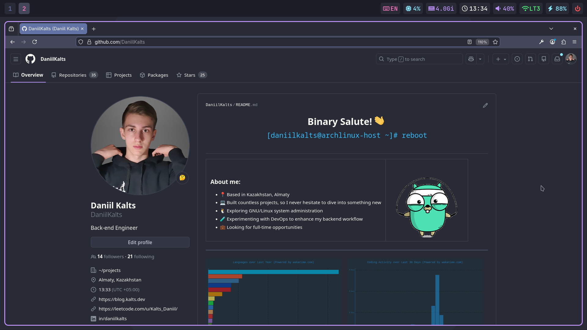

### Preview
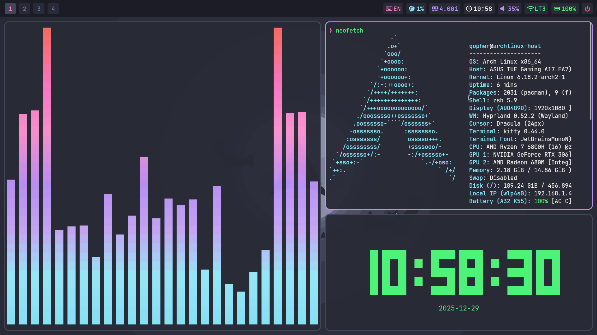

### Wallpaper Selector
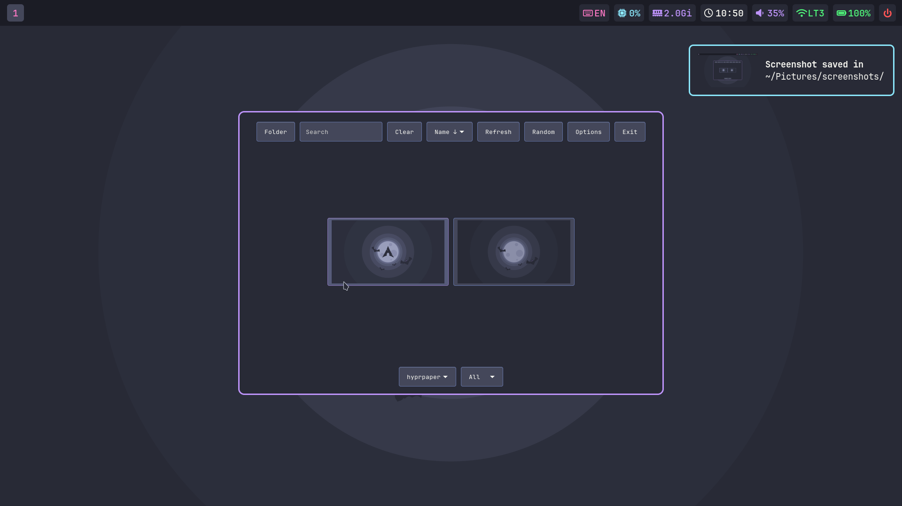

### System Monitor
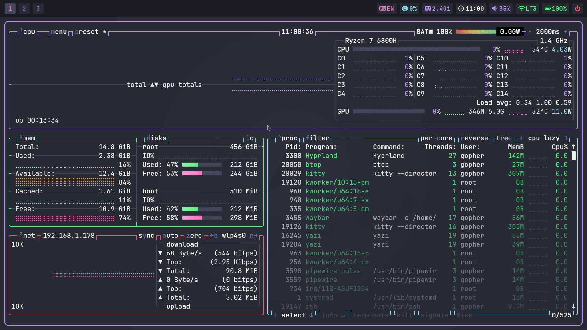

### Program Launcher
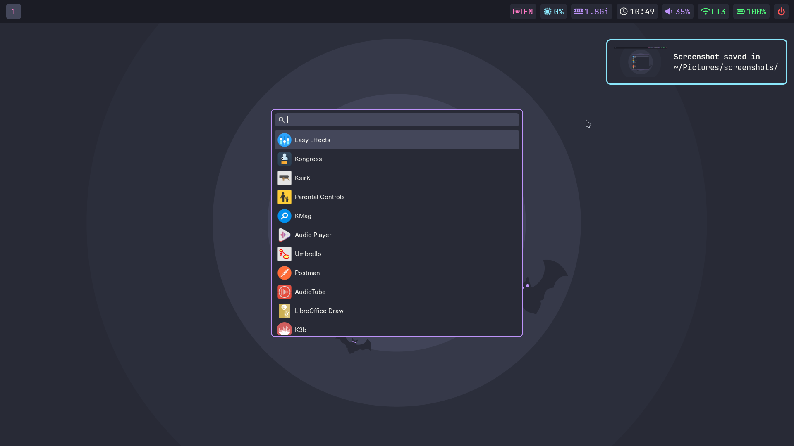

### Ai Menu
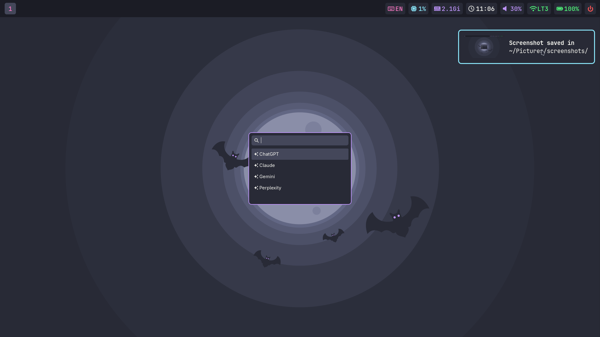

### Dracula Chatgpt
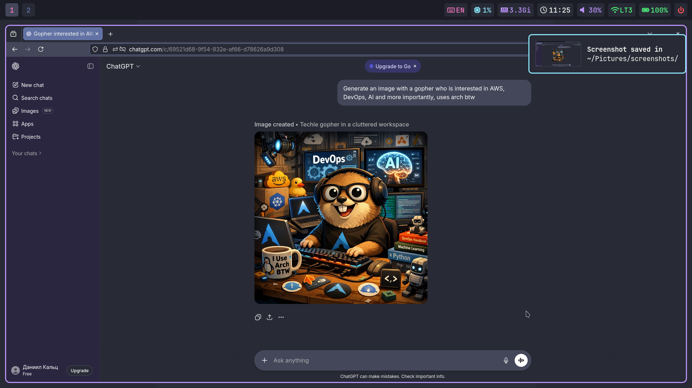

### Dracula Gemini
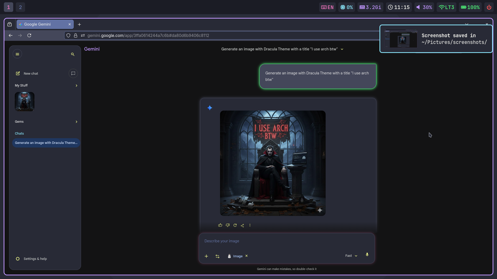

### Gemini Cli
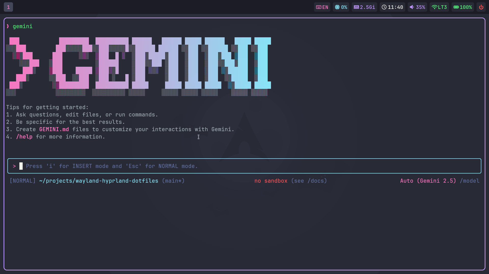

### Claude Cli
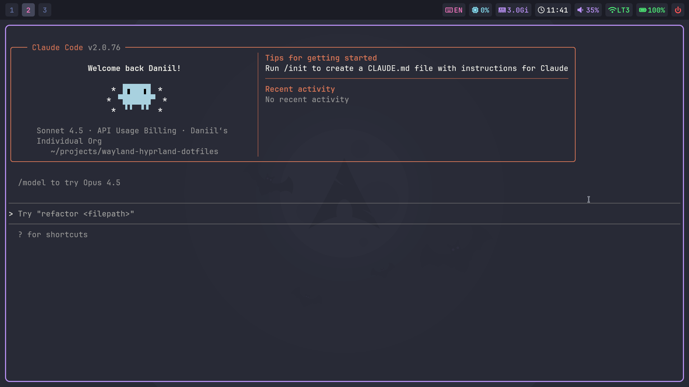

### Neovim
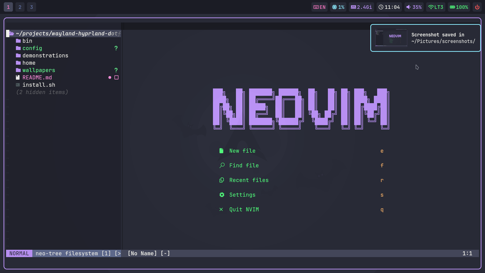

### File Listing
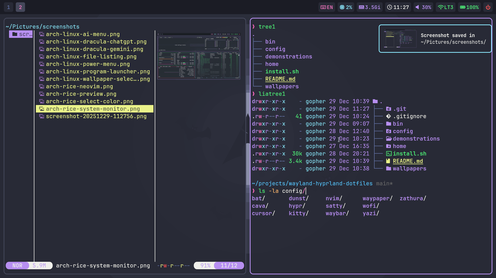

### Screenshot Edit
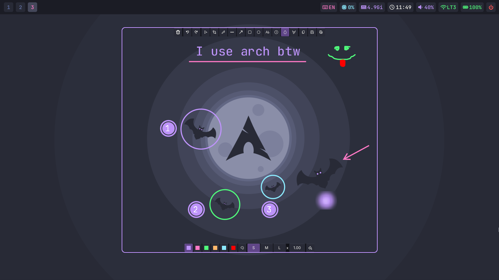

### Select Color
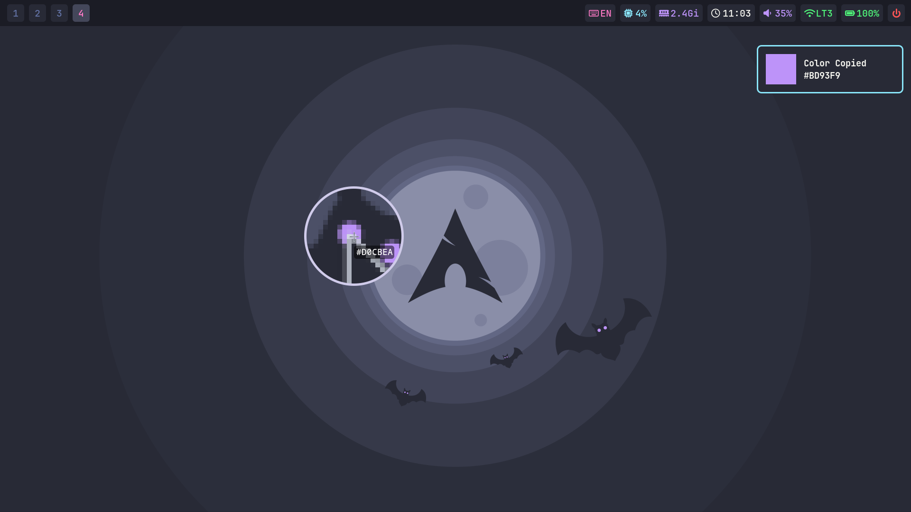

### Power Menu
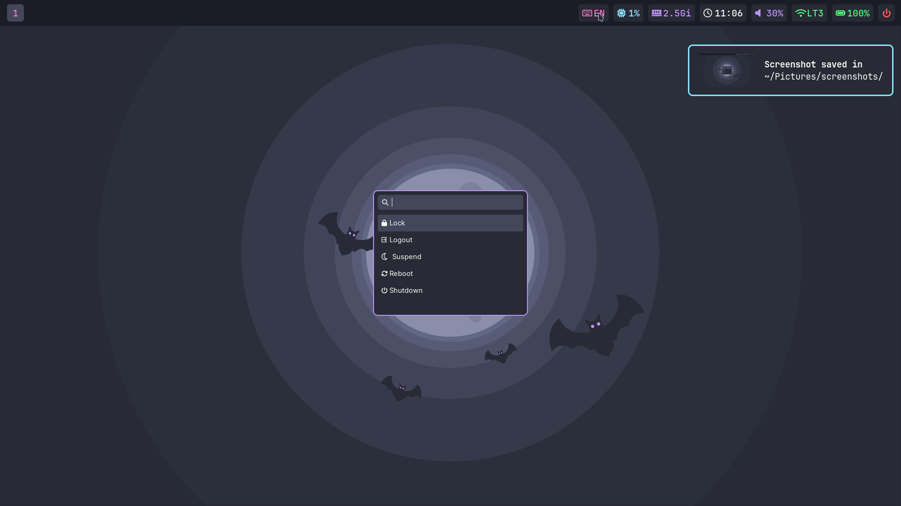

## 💻 HotKeys

- **Open the terminal** - `super + enter`
- **Close the focused window** - `super + w`
- **Switch to a workspace** - `super + 1-9`
- **Move the window to a workspace** - `super + shift + 1-9`
- **Focus a neighbouring window** - `super + h/j/k/l`
- **Float / tile / fullscreen the window** - `super + s` / `super + n` / `super + f`
- **Application menu** - `super + d`
- **Power menu** - `super + q`
- **AI menu** - `super + c`
- **IDE menu** - `super + i`
- **Clipboard history** - `super + shift + c`
- **Wallpaper selector** - `super + shift + s`
- **Screenshot the screen to a file** - `super + p`
- **Screenshot a region and annotate it** - `super + shift + p`
- **Screenshot the screen / a region to the clipboard** - `super + ctrl + p` / `super + ctrl + shift + p`
- **Lock the screen** - `super + escape`
- **Log out** - `super + alt + q`
- **Pick a color to the clipboard** - `alt + p`
- **Open Yazi in a new terminal tab** - `ctrl + y`

All bindings live in `config/hypr/.config/hypr/modules/bindings.lua`.

## 🛠️ Installation

Run the installer from the root of the repository. It links the configs and `bin/` scripts into place with Stow, so edits in the repository apply immediately.

```
./install.sh
```
